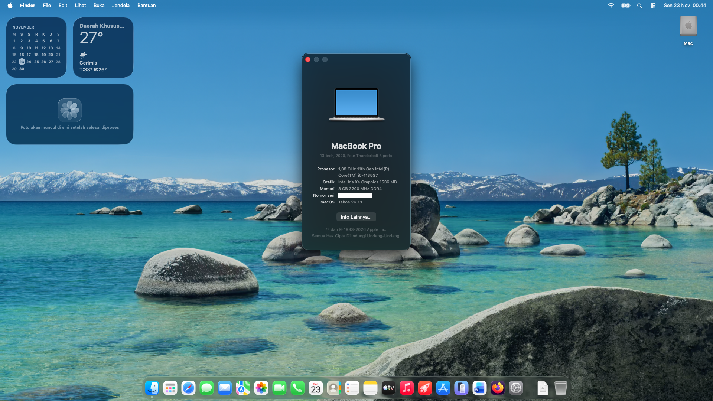

# Dell Latitude 5320 — macOS Tahoe 26.7.1 (25G241) 🍏💻

-000000?style=flat-square&logo=apple&logoColor=white)

## 💻 Specifications
| Component | Detail |
| :--- | :--- |
| **Laptop Model** | Dell Latitude 5320 |
| **Processor** | Intel Core i5-1135G7 (11th Gen) |
| **Graphics** | Intel Iris Xe Graphics |
| **Memory** | 8GB DDR4 On-Board |
| **Audio Codec** | Realtek ALC259 |

## ✅ Status
Smooth & daily-ready, almost all features work properly!

## 📸 Screenshots

